<p align="center">
  <picture>
    <source media="(prefers-color-scheme: dark)" srcset="assets/banner-dark.svg">
    <source media="(prefers-color-scheme: light)" srcset="assets/banner-light.svg">
    
  </picture>
</p>

```python
from yassien import Engineer

me = Engineer(city="Cairo", works_on=["Keras", "ONNX", "vLLM", "FastAPI"])
me.ask("What do you do?")
# I port models into Keras, fix the serving stack under them (vLLM, ONNX,
# OpenVINO), and ship the result as FastAPI services that run in production.
```

AI engineer from Cairo working where models meet systems: architectures, speed, and production backends. Code merged into [Google's KerasHub](https://github.com/keras-team/keras-hub), [ONNX](https://github.com/onnx/onnx), [vLLM](https://github.com/vllm-project/vllm) and [Keras OpenVINO](https://github.com/keras-team/keras-openvino).

- 📖 Reading *Designing Data-Intensive Applications*, *Fluent Python*, *Fundamentals of Software Engineering*
- 💬 Open to junior AI and Python backend roles in Cairo, and to freelance work

<a href="https://www.linkedin.com/in/yassien-wasfy-315ab5349"></a>
<a href="https://kaggle.com/yassienwasfy"></a>
<a href="https://huggingface.co/masterofaudio2077"></a>
<a href="mailto:yassienashraf2025@gmail.com"></a>

## 🧩 Open source

Pull requests I got merged into the libraries I use. Each tile opens its pull request.

<p align="center">
  <a href="https://github.com/keras-team/keras-hub/pull/2699">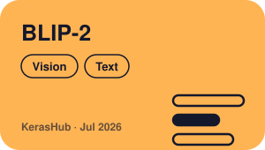</a>
  <a href="https://github.com/keras-team/keras-hub/pull/2932">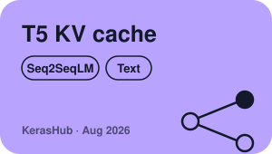</a>
  <a href="https://github.com/vllm-project/vllm/pull/66289">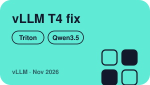</a>
  <a href="https://github.com/onnx/onnx/pull/8266">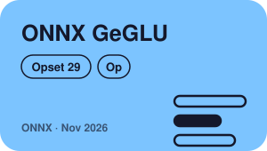</a>
  <a href="https://github.com/keras-team/keras-openvino/pull/66">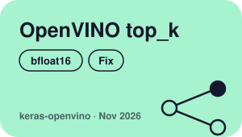</a>
  <a href="https://github.com/keras-team/keras-hub/pull/3186">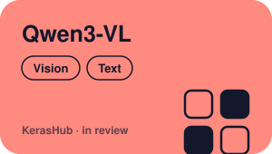</a>
</p>

- **BLIP-2** ([#2699](https://github.com/keras-team/keras-hub/pull/2699)): a vision-language model with weight-conversion scripts and numerical-parity tests against OPT-2.7B/6.7B and Flan-T5-XL/XXL checkpoints (5.0K lines, 32 files).
- **T5 KV caching and a `Seq2SeqLM` task** ([#2932](https://github.com/keras-team/keras-hub/pull/2932)): removes redundant recomputation during autoregressive decoding.
- **vLLM** ([#66289](https://github.com/vllm-project/vllm/pull/66289), bug [#66288](https://github.com/vllm-project/vllm/issues/66288)): Qwen3.5 compiled GPU kernels at startup and could fail to build on T4 GPUs. The fix uses a Triton kernel on GPUs older than SM80, so nothing needs compiling.
- **ONNX** ([#8266](https://github.com/onnx/onnx/pull/8266)): added GeGLU as a function operator at opset 29.
- **Keras OpenVINO** ([#66](https://github.com/keras-team/keras-openvino/pull/66)): fixed `top_k` on bfloat16 inputs, which was breaking KerasHub's OpenVINO CI.
- **In review:** Qwen3-VL for KerasHub ([#3186](https://github.com/keras-team/keras-hub/pull/3186), 33 files), shared model-test helpers that remove duplicated tests ([#3184](https://github.com/keras-team/keras-hub/pull/3184)), and a 2D multi-organ segmentation example with TransUNet for keras.io ([#2361](https://github.com/keras-team/keras-io/pull/2361)).
- Filed 21 issues across Keras, KerasHub, keras-io, JAX and vLLM; maintainers fixed 4 of my 6 bug reports in Keras, KerasHub and JAX.

## 🛠️ Projects

<p align="center">
  <a href="https://github.com/yassienashrafwasfy/PII-Masking-System">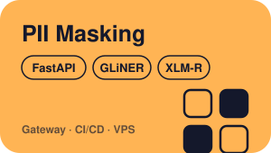</a>
  <a href="https://github.com/yassienashrafwasfy/hadith-search">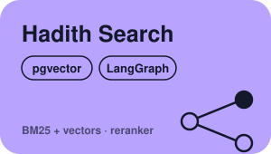</a>
  <a href="https://huggingface.co/masterofaudio2077">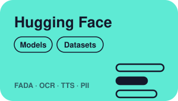</a>
</p>

- **[PII Masking System](https://github.com/yassienashrafwasfy/PII-Masking-System):** masks personal data in PDF, text, CSV and JSON. One gateway routes each request to a private per-team model service (XLM-RoBERTa, GLiNER, MedRoBERTa) that runs a shared detection and redaction pipeline, then returns masked files with consistent fake replacements. Comes with an evaluation leaderboard, CI/CD and VPS deployment.
- **[AI-powered Hadith Search](https://github.com/yassienashrafwasfy/hadith-search):** full-stack Arabic search over the six hadith books with FastAPI, PostgreSQL, pgvector, React, TypeScript and LangGraph. Hybrid BM25 + vector search with rank fusion, spelling suggestions and a reranker; the embedding model is shrunk and served with ONNX Runtime. 84 of the 121 commits are mine.
- **[Models and datasets on Hugging Face](https://huggingface.co/masterofaudio2077):** [FADA](https://huggingface.co/masterofaudio2077/Fada_ar_embedding), an Arabic embedding model (similarity score 48.5 → 69.1, ahead of multilingual-e5-small); an [Arabizi to Arabic converter](https://huggingface.co/masterofaudio2077/byt5-small-arabizi-word); an [Arabic book OCR model](https://huggingface.co/masterofaudio2077/arabic-nougat-base-books-ocr) (0.9% character error rate); an [Egyptian Arabic text-to-speech model](https://huggingface.co/masterofaudio2077/voicetut-egyptian-tashkeel) fine-tuned on 59 hours of voweled speech; and labelled Egyptian Arabic datasets such as [2,466 PII call scripts](https://huggingface.co/datasets/masterofaudio2077/egyptian-pii-call-scripts).

## 📈 In numbers

<p align="center">
  <a href="https://huggingface.co/masterofaudio2077">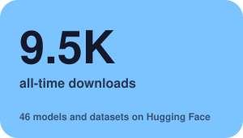</a>
  <a href="https://kaggle.com/yassienwasfy">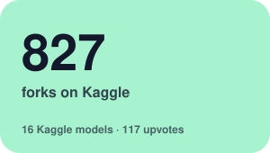</a>
  <a href="https://github.com/yassienashrafwasfy">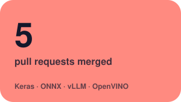</a>
</p>

<sub>Hugging Face counts are all-time downloads from the Hub API on 19 Nov 2026. Kaggle figures are from my Kaggle profile.</sub>

## 💼 Experience

**AI Engineer Intern** | Cegedim, Cairo, Egypt | Jul 2026 – Sep 2026

Personal-data masking platform for Dutch, French and English medical letters and PDFs, used by 3 AI teams. Team of 6.

- Wrote 49% of its Python (24,863 of 50,897 lines by `git blame`), the most of the 6 engineers.
- Cut text-processing time 30% (1,189 to 835 ms) and cache memory 57% (15.4 to 6.7 MB) after profiling with Scalene.
- Added French and English support, new ID types (SSN, NPI, NHS number, GMC) and scanned-page reading; routed each document to the right language model with a rollback switch (XLM-RoBERTa, ONNX Runtime, PP-OCRv6).
- Wrote the training code and datasets for the detector, the versioned API contracts (v1.2 to v1.4) and the PDF redaction that keeps the page layout.
- Wrote about half of all tests, fixed about 39 bugs, and closed a leak that saved detected personal data in clear text.

**AI Trainee** | NAID, New Capital, Egypt | Jul 2025 – Sep 2025

**Full-Stack Trainee** | NAID, New Capital, Egypt | Jul 2024 – Sep 2024

## 🧰 Toolkit

**Languages & backend** &nbsp;


**ML frameworks** &nbsp;


**Data** &nbsp;


**Training at scale** &nbsp;


**Deploy & optimize** &nbsp;


